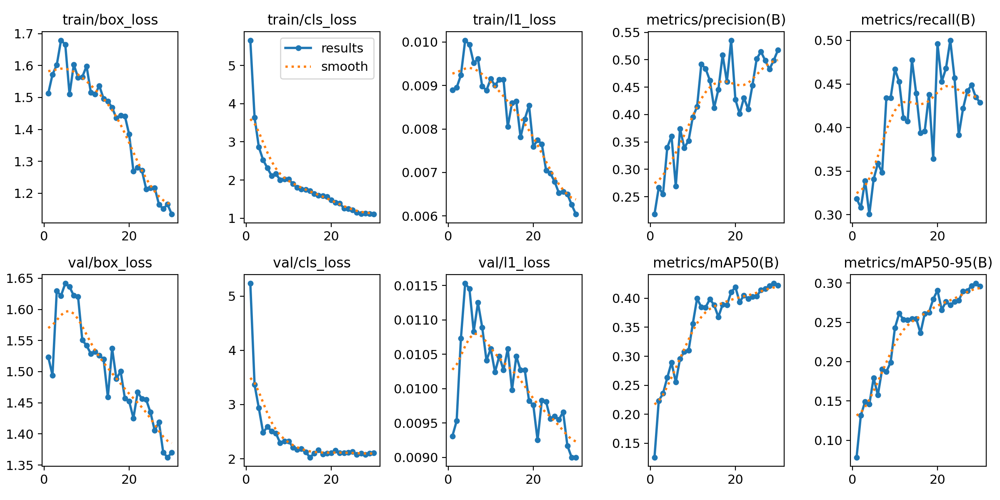
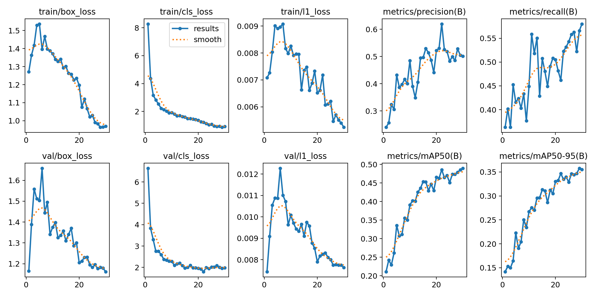
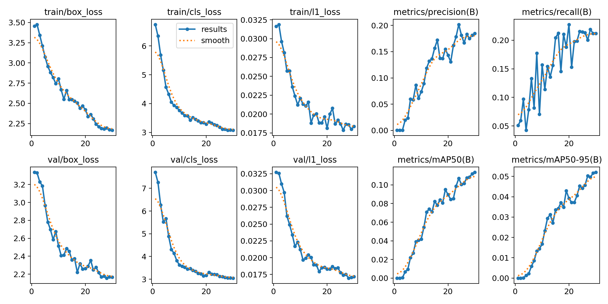

# Pj1 RET503 — Sistem Persepsi Robot Trash Picking

**Nama:** Sara Devina Pardede
**NIM:** 4222411053
**Sidik jari dataset:** 35D76BF59253
**Lingkungan:** Google Colab, GPU Tesla T4, Ultralytics 8.4.175, model YOLO26n

📦 **Dataset lengkap + semua hasil pelatihan (zip, ±360 MB):** [Google Drive](https://drive.google.com/file/d/1uOJMaHtEaopq6ZHJmBQT0fax8ybjJTef/view?usp=sharing)

> Catatan: target kinerja dan pipeline di bagian 2–3 adalah **rancangan usulan** pada tahap konsep. Nilainya akan disesuaikan setelah perangkat keras robot final ditetapkan bersama kelompok.

---

## 1. Lingkup persepsi dari misi projek
Robot trash picking bertugas menemukan sampah di permukaan tanah lalu mengambilnya. Sistem persepsi harus menjawab dua hal untuk setiap sampah yang terlihat kamera: **apa jenisnya** (kelas) dan **di mana posisinya** (bounding box). Posisi kotak dipakai untuk mengarahkan robot dan gripper.

Kelas yang dideteksi:

| class_id | Kelas | Isi (superkategori TACO) |
|---|---|---|
| 0 | plastik | Plastic bag & wrapper: plastik lembaran, bungkus snack, kantong kresek, kantong sampah |
| 1 | botol | Bottle: botol plastik bening, botol plastik lain, botol kaca |
| 2 | kaleng | Can: kaleng minuman, kaleng makanan, aerosol |

## 2. Target kinerja
| Metrik | Target | Hasil (model E3) | Status |
|---|---|---|---|
| mAP50 (test) | ≥ 0.50 | 0.496 | hampir tercapai |
| mAP50-95 (test) | ≥ 0.35 | 0.380 | tercapai |
| Recall (val) | ≥ 0.60 | 0.549 | belum tercapai |
| Kecepatan | ≥ 10 FPS | 5.0 ms/gambar di GPU T4 (≈ 200 FPS, inferensi saja) | perlu diukur di perangkat robot |
| Latensi total (kamera → keputusan) | ≤ 100 ms | – | perlu diukur di perangkat robot |

Alasan pemilihan target:
- **Recall diprioritaskan.** Sampah yang tidak terdeteksi (FN) pasti tertinggal, sedangkan deteksi palsu (FP) hanya membuang satu gerakan gripper. Karena itu target recall dibuat paling tinggi.
- **mAP50 dipakai sebagai acuan utama, bukan mAP50-95.** Robot hanya perlu tahu posisi sampah kira-kira untuk mengarahkan gripper, jadi kotak tidak harus pas sempurna.
- **10 FPS** dipilih karena robot bergerak pelan (sekitar 0,2–0,3 m/s). Dengan 10 FPS, robot hanya bergerak sekitar 2–3 cm di antara dua frame, sehingga sampah tidak terlewat.

## 3. Rancangan pipeline
```
Kamera USB → ambil frame → resize 640 px → YOLO26n → NMS
  → kotak + kelas + confidence (ambang confidence rendah, misalnya 0.25, demi recall)
  → pilih sampah terdekat (kotak paling bawah di gambar)
  → posisi kotak diubah menjadi arah gerak robot → robot mendekat → gripper mengambil
```

| Komponen | Usulan | Alasan |
|---|---|---|
| Kamera | Webcam USB 720p (1280×720) | murah dan mudah didapat; resolusinya cukup karena input model hanya 640 px |
| Posisi kamera | di depan robot, tinggi sekitar 30–40 cm, menghadap ke tanah sekitar 45° | area di depan robot terlihat, dan sampah tampak cukup besar di gambar |
| Perangkat pemroses | laptop (tahap pengembangan); target akhir Raspberry Pi 5 atau NVIDIA Jetson | YOLO26n adalah model terkecil (nano), sehingga paling mungkin berjalan di perangkat kecil |
| Model | YOLO26n, imgsz 640 (hasil E3) | model terpilih dari eksperimen |

Risiko yang perlu diperhatikan:
- **Kecepatan.** 5.0 ms diukur di GPU T4. Di Raspberry Pi tanpa GPU, inferensinya bisa jauh lebih lambat. Jika target 10 FPS tidak tercapai, opsi berikutnya adalah menurunkan imgsz (misalnya ke 416, sesuai hasil E1), atau ekspor model ke format yang lebih cepat (ONNX/NCNN, materi minggu 10–11).
- **Perbedaan sudut pandang.** Foto TACO diambil manusia dengan kamera HP dari berbagai sudut, sedangkan kamera robot dipasang tetap dan rendah. Model perlu diuji dan ditambah data dari kamera robot sendiri (dataset_v2).

---

## 4. Dataset (Tahap 1–2)

### Sumber
Kelas kertas dan bungkus plastik tidak ada di COCO, jadi data diambil dari **TACO (Trash Annotations in Context)**. TACO adalah dataset foto sampah asli di lingkungan sekitar (tanah, rumput, jalan), dengan anotasi format COCO dan lisensi MIT ([github.com/pedropro/TACO](https://github.com/pedropro/TACO)). Totalnya 1.500 gambar dan 60 kategori yang dikelompokkan menjadi 28 superkategori.

Program `00_ambil_subset_taco.py` menggantikan `00_ambil_subset_coco.py`. Keluarannya sama, sehingga program 01–06 dari dosen dipakai tanpa diubah. Program ini:
1. memilih gambar yang berisi superkategori pilihan, ditambah 10% gambar latar;
2. mengunduh gambar dari Flickr, memutarnya sesuai EXIF, dan memperkecilnya ke sisi terpanjang 640 px;
3. mengubah bbox COCO menjadi label YOLO.

### Ringkasan data
| Kelas | Jumlah kotak |
|---|---|
| plastik | 850 |
| botol | 439 |
| kaleng | 273 (minoritas) |

- 981 gambar: 892 berobjek dan 89 latar. Tidak ada yang gagal diunduh.
- `01_cek_anotasi.py`: semua gambar punya label. Ada 40 peringatan kotak sangat kecil (di bawah 8 px). Itu sampah kecil di kejauhan dan tetap dipertahankan.
- Cek visual: kotak tepat mengelilingi sampah.
- Uji konversi YOLO → COCO → YOLO: selisih koordinat sekitar 0.000006 (0.855263 menjadi 0.855257), akibat pembulatan 2 desimal di program 02. Ini jauh di bawah 1 piksel, jadi aman.
- Pembagian data: **train 686, val 196, test 99** gambar.

---

## 5. Hasil eksperimen (Tahap 3–5)
Pengaturan yang sama untuk semua eksperimen: epochs 30, imgsz 416, batch 16, seed 0.

| Eksperimen | Perubahan | mAP50 | mAP50-95 | P | R | ms/gambar | Menit latih |
|---|---|---|---|---|---|---|---|
| E1_pretrained | – (baseline) | 0.431 | 0.302 | 0.514 | 0.445 | 4.8 | 5.7 |
| E2_scratch | bobot acak | 0.113 | 0.052 | 0.186 | 0.224 | 3.6 | 5.5 |
| E3_tuning | imgsz=640 | **0.485** | **0.359** | 0.508 | 0.549 | 5.0 | 7.5 |

**Model terpilih:** E3_tuning (mAP50-95 val tertinggi)
**Hasil di data TEST:** mAP50 **0.496**, mAP50-95 **0.380**

### Per kelas (val, mAP50-95)
| Kelas | Kotak | E1 | E3 | Perubahan |
|---|---|---|---|---|
| plastik | 850 | 0.233 | 0.278 | +0.045 |
| botol | 439 | 0.371 | **0.443** | +0.072 |
| kaleng | 273 | 0.302 | 0.355 | +0.053 |

### Grafik pelatihan
**E1_pretrained**



**E3_tuning (model terpilih)**



**E2_scratch**



---

## 6. Analisis

### a. Transfer learning (E1 vs E2)
E1 mencapai mAP50-95 0.302, sedangkan E2 hanya 0.052, dengan data dan epoch yang sama. Log pelatihan menunjukkan `Transferred 696/708 items`. Bobot backbone dan neck COCO dipakai ulang, tetapi bagian kelas di head dibuat baru karena plastik, botol, dan kaleng bukan nama kelas COCO. Model sudah membawa kemampuan mengenali tepi, tekstur, dan bentuk, sehingga cukup belajar membedakan tiga jenis sampah. E2 harus belajar semuanya dari nol, dan 686 gambar dengan 30 epoch belum cukup.

### b. Tuning imgsz=640 (E1 vs E3)
Menaikkan imgsz dari 416 ke 640 menaikkan mAP50-95 val dari 0.302 ke 0.359 (+0.057), dan recall dari 0.445 ke 0.549. Semua kelas membaik. Perubahan ini **dipertahankan**. Sampah sering tampak kecil di foto, sehingga resolusi input yang lebih besar membantu. Biayanya kecil: inferensi naik dari 4.8 ke 5.0 ms/gambar di T4, dan waktu latih naik dari 5.7 ke 7.5 menit.

### c. Kurva pelatihan
Loss train dan loss val sama-sama turun tanpa berbalik naik, jadi **tidak ada overfitting**. mAP50-95 val E1 dan E3 **masih naik di epoch 30**, misalnya E3 dari 0.15 di epoch 1 ke 0.36 di epoch 30. Artinya model belum mencapai batasnya, dan pelatihan lebih lama layak dicoba.

### d. Kelas: data banyak belum tentu mudah
**Plastik** punya data paling banyak (850 kotak) tetapi AP-nya **paling rendah** (0.278). **Botol** paling tinggi (0.443). Kemungkinan penyebabnya:
- Bentuk plastik tidak tetap: bisa terlipat, kusut, sobek, dan transparan. Ukurannya juga sangat beragam, dari serpihan kecil sampai kantong besar. Menentukan batas kotak yang tepat lebih sulit, dan mAP50-95 menuntut kotak yang pas.
- Botol punya bentuk khas yang konsisten, sehingga lebih mudah dikenali.
- Ada sampah plastik lain di TACO (superkategori "Other plastic" dan "Unlabeled litter") yang tidak termasuk dataset ini dan tidak diberi kotak. Jika model mendeteksinya sebagai plastik, deteksi itu dihitung sebagai FP walaupun bendanya memang sampah.

Kaleng, kelas minoritas, tetap berada di tengah (0.355). Ketidakseimbangan jumlah data bukan satu-satunya faktor. Variasi bentuk dan kualitas batas objek juga berpengaruh besar.

### e. Hasil test
Pada data test (99 gambar, 186 objek), mAP50-95 = 0.380. Angka ini dekat dengan val (0.359). Artinya model tidak hanya bagus di data yang dipakai untuk memilihnya, dan kinerjanya konsisten di data yang belum pernah dilihat.

---

## 7. Kesimpulan dan langkah berikutnya
1. Transfer learning dari COCO sangat berpengaruh: 0.302 dibanding 0.052 mAP50-95.
2. imgsz=640 meningkatkan semua kelas. Model terpilih E3 mendapat mAP50-95 test **0.380** dan mAP50 0.496.
3. Kelas tersulit adalah plastik, karena bentuknya tidak tetap, bukan karena kekurangan data.

Eksperimen berikutnya (satu perubahan per eksperimen):
- **E4: `epochs=60`**, karena kurva mAP val masih naik di epoch 30.
- **dataset_v2:** tambahkan foto dari kamera robot sendiri, di lantai atau lingkungan tempat robot akan dipakai. TACO diambil dengan kamera HP dari berbagai sudut, sedangkan robot melihat dari posisi tetap. Perbedaan kondisi ini perlu ditutup dengan data sendiri.
- Pertimbangkan menggabungkan "Other plastic" ke kelas plastik, supaya sampah plastik yang mirip tidak dihitung sebagai FP.

## 8. Isi repository
| File/folder | Isi |
|---|---|
| `README.md` | laporan ini |
| `00_ambil_subset_taco.py` | program pengambil data TACO (pengganti program 00 COCO) |
| `PJ1_Sampah_TACO_Colab.ipynb` | notebook Colab yang dijalankan dari awal sampai akhir |
| `hasil_praktik_4222411053.txt` / `.csv` | tabel hasil otomatis dari program 06 |
| `hasil_praktik/E1_pretrained/`, `E2_scratch/`, `E3_tuning/` | bobot (`weights/best.pt`), `results.png`, `results.csv`, `confusion_matrix.png`, `args.yaml` |
| [Google Drive](https://drive.google.com/file/d/1uOJMaHtEaopq6ZHJmBQT0fax8ybjJTef/view?usp=sharing) | zip lengkap: `dataset_v1/` (gambar, label, `data.yaml`), cek visual anotasi, dan semua hasil |

Program 01–06 berasal dari materi kuliah RET503 dan dipakai tanpa diubah.

## Referensi
- Proença, P. F., & Simões, P. (2020). *TACO: Trash Annotations in Context for Litter Detection*. arXiv:2003.06975.
- Ultralytics Docs, "COCO Dataset"; Ultralytics Academy, "Prepare a Custom Dataset".
